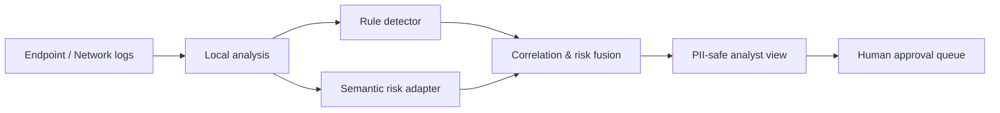

# Aegis-ON

> 개인정보를 외부로 반출하지 않고, 규칙 기반 탐지와 행위 분석을 결합하는 사람 승인형 AI 보안관제 MVP

## 현재 구현 범위

- JSON 보안 이벤트 배치 분석
- 알려진 위험 명령·도구전송 징후에 대한 설명 가능한 규칙 탐지
- 명령줄 의미 신호를 이용한 **임시 기준선(heuristic) 행위 위험도** 산정
- 호스트·시간창·대상 수 기반 스캔 팬아웃 상관분석
- 이메일·전화번호·IP 주소의 표시용 가명처리
- 탐지 근거, MITRE ATT&CK 기법, 위험 점수 및 사람 승인 상태를 API로 제공

> 현재 `SemanticRiskAdapter`는 Transformer가 아닌 검증 가능한 기준선입니다. 대회 제출 시 실제 BERT/보안 로그 분류 모델을 붙이기 전까지 AI 모델 성능을 주장하지 않습니다.

## 빠른 시작

```bash
python -m venv .venv
source .venv/bin/activate
pip install -r requirements.txt
export AEGIS_API_TOKEN="$(python -c 'import secrets; print(secrets.token_urlsafe(32))')"
export AEGIS_ANALYST_NAME="analyst-1"
uvicorn --app-dir src aegis_on.api:app --reload
```

브라우저에서 `http://127.0.0.1:8000`을 열고 데모 버튼을 누르면 API 토큰을 입력합니다. 생성된 토큰은 `printf '%s\n' "$AEGIS_API_TOKEN"`으로 확인할 수 있습니다. API 문서는 `http://127.0.0.1:8000/docs`에서 확인하고 Authorize에 토큰을 입력합니다.

샘플 이벤트 분석:

```bash
curl -X POST http://127.0.0.1:8000/api/v1/analyze \
  -H 'Content-Type: application/json' \
  -H "Authorization: Bearer $AEGIS_API_TOKEN" \
  --data @data/demo_events.json
```

분석, 탐지 목록, 승인 API에는 Bearer 토큰이 필요합니다. 토큰 또는 분석가 이름이 설정되지 않으면 API는 요청을 거부합니다. 승인 요청의 `analyst`는 `AEGIS_ANALYST_NAME`과 일치해야 합니다. 현재 인증은 **단일 공유 토큰과 단일 분석가를 위한 MVP**이며 다중 사용자 인증이나 역할 관리를 제공하지 않습니다. 토큰과 이름은 신뢰하는 분석가에게만 제공하고, 네트워크에 노출할 때는 암호화된 연결과 별도의 접근 통제가 필요합니다.

Docker를 사용한다면 환경 변수를 컨테이너에 전달하고 호스트의 루프백에 포트를 연결합니다.

```bash
docker build -t aegis-on .
docker run --rm -p 127.0.0.1:8000:8000 -e AEGIS_API_TOKEN -e AEGIS_ANALYST_NAME aegis-on
```

분석 결과의 `event_refs`는 요청의 0부터 시작하는 `input_index`와 해당 `event_id`를 연결합니다. ID가 없는 입력도 응답을 통해 원본 입력 위치를 찾을 수 있습니다. 한 요청 안에서 `event_id`가 중복되거나 표시용 가명처리 이후 같아지면 요청이 거부됩니다. 이벤트 원본과 이 매핑은 서버에 영구 저장되지 않으므로 원본과 응답을 필요한 곳에 함께 보관해야 합니다. 상관분석은 한 번의 요청에 포함된 이벤트에 적용됩니다.

회귀 테스트를 포함한 테스트 실행:

```bash
pip install -r requirements-dev.txt
PYTHONPATH=src python -m unittest discover -s tests -v
```

## 설계



## 다음 구현 우선순위

1. Sysmon·웹 프록시 로그 정규화 커넥터
2. `SemanticRiskAdapter`를 다중 라벨 ATT&CK 분류 모델로 교체
3. PostgreSQL 영속화와 조직별 자산 중요도
4. 승인된 격리 요청을 EDR/SOAR에 전달하는 어댑터

실제 대응 어댑터는 기본적으로 비활성화하며, 사람의 승인과 대상 범위 확인 없이는 단말·계정·네트워크를 변경하지 않습니다.
