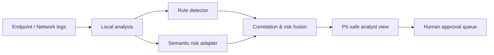

# Aegis-ON

> 개인정보를 외부로 반출하지 않고, 규칙 기반 탐지와 행위 분석을 결합하는 사람 승인형 AI 보안관제 MVP

## 현재 구현 범위

- JSON 보안 이벤트 배치 분석
- 알려진 위험 명령·도구전송 징후에 대한 설명 가능한 규칙 탐지
- 명령줄 의미 신호를 이용한 **임시 기준선(heuristic) 행위 위험도** 산정
- 호스트·시간창·대상 수 기반 스캔 팬아웃 상관분석
- 이메일·전화번호·IP 주소의 표시용 가명처리
- 탐지 근거, MITRE ATT&CK 기법, 위험 점수 및 사람 승인 상태를 API로 제공

> 현재 `SemanticRiskAdapter`는 Transformer가 아닌 검증 가능한 기준선입니다. 대회 제출 시 실제 BERT/보안 로그 분류 모델을 붙이기 전까지 AI 모델 성능을 주장하지 않습니다.

## 빠른 시작

```bash
python -m venv .venv
source .venv/bin/activate
pip install -r requirements.txt
uvicorn --app-dir src aegis_on.api:app --reload
```

브라우저에서 `http://127.0.0.1:8000`을 열고, API 문서는 `http://127.0.0.1:8000/docs`에서 확인합니다.

샘플 이벤트 분석:

```bash
curl -X POST http://127.0.0.1:8000/api/v1/analyze \
  -H 'Content-Type: application/json' \
  --data @data/demo_events.json
```

## 설계



## 다음 구현 우선순위

1. Sysmon·웹 프록시 로그 정규화 커넥터
2. `SemanticRiskAdapter`를 다중 라벨 ATT&CK 분류 모델로 교체
3. PostgreSQL 영속화와 조직별 자산 중요도
4. 승인된 격리 요청을 EDR/SOAR에 전달하는 어댑터

실제 대응 어댑터는 기본적으로 비활성화하며, 사람의 승인과 대상 범위 확인 없이는 단말·계정·네트워크를 변경하지 않습니다.
