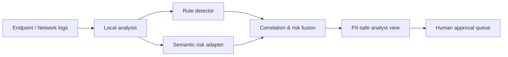

# Aegis-ON

> 개인정보를 외부로 반출하지 않고, 규칙 기반 탐지와 행위 분석을 결합하는 사람 승인형 AI 보안관제 MVP

## 현재 구현 범위

- JSON 보안 이벤트 배치 분석
- Sysmon Event ID 1·3 JSON 배치 수집 및 정규화
- 알려진 위험 명령·도구전송 징후에 대한 설명 가능한 규칙 탐지
- 명령줄 의미 신호를 이용한 **임시 기준선(heuristic) 행위 위험도** 산정
- 호스트·시간창·대상 수 기반 스캔 팬아웃 상관분석
- 이메일·전화번호·IP 주소의 표시용 가명처리
- 탐지 근거, MITRE ATT&CK 기법, 위험 점수 및 사람 승인 상태를 API로 제공

> 현재 `SemanticRiskAdapter`는 Transformer가 아닌 검증 가능한 기준선입니다. 대회 제출 시 실제 BERT/보안 로그 분류 모델을 붙이기 전까지 AI 모델 성능을 주장하지 않습니다.

## 빠른 시작

```bash
python -m venv .venv
source .venv/bin/activate
pip install -r requirements.txt
export AEGIS_API_TOKEN="$(python -c 'import secrets; print(secrets.token_urlsafe(32))')"
export AEGIS_ANALYST_NAME="analyst-1"
uvicorn --app-dir src aegis_on.api:app --reload
```

브라우저에서 `http://127.0.0.1:8000`을 열고 데모 버튼을 누르면 API 토큰을 입력합니다. 생성된 토큰은 `printf '%s\n' "$AEGIS_API_TOKEN"`으로 확인할 수 있습니다. API 문서는 `http://127.0.0.1:8000/docs`에서 확인하고 Authorize에 토큰을 입력합니다.

샘플 이벤트 분석:

```bash
curl -X POST http://127.0.0.1:8000/api/v1/analyze \
  -H 'Content-Type: application/json' \
  -H "Authorization: Bearer $AEGIS_API_TOKEN" \
  --data @data/demo_events.json
```

분석, 탐지 목록, 승인 API에는 Bearer 토큰이 필요합니다. 토큰 또는 분석가 이름이 설정되지 않으면 API는 요청을 거부합니다. 승인 요청의 `analyst`는 `AEGIS_ANALYST_NAME`과 일치해야 합니다. 현재 인증은 **단일 공유 토큰과 단일 분석가를 위한 MVP**이며 다중 사용자 인증이나 역할 관리를 제공하지 않습니다. 토큰과 이름은 신뢰하는 분석가에게만 제공하고, 네트워크에 노출할 때는 암호화된 연결과 별도의 접근 통제가 필요합니다.

Docker를 사용한다면 환경 변수를 컨테이너에 전달하고 호스트의 루프백에 포트를 연결합니다.

```bash
docker build -t aegis-on .
docker run --rm -p 127.0.0.1:8000:8000 -e AEGIS_API_TOKEN -e AEGIS_ANALYST_NAME aegis-on
```

분석 결과의 `event_refs`는 요청의 0부터 시작하는 `input_index`와 해당 `event_id`를 연결합니다. ID가 없는 입력도 응답을 통해 원본 입력 위치를 찾을 수 있습니다. 한 요청 안에서 `event_id`가 중복되거나 표시용 가명처리 이후 같아지면 요청이 거부됩니다. 이벤트 원본과 이 매핑은 서버에 영구 저장되지 않으므로 원본과 응답을 필요한 곳에 함께 보관해야 합니다. 상관분석은 한 번의 요청에 포함된 이벤트에 적용됩니다.

회귀 테스트를 포함한 테스트 실행:

```bash
pip install -r requirements-dev.txt
PYTHONPATH=src python -m unittest discover -s tests -v
```

## 설계



## Sysmon 로그 분석

Windows Sysmon의 **Event ID 1(프로세스 생성)**과 **Event ID 3(네트워크 연결)**을 지원합니다. Event ID 3은 Sysmon 설정에서 네트워크 이벤트 수집을 활성화해야 생성됩니다. 지원 입력은 이 저장소의 PowerShell 스크립트가 만드는 UTF-8 JSON입니다. Windows 이벤트 뷰어 XML이나 EVTX 파일은 직접 읽지 않습니다.

Windows PowerShell에서 저장소 루트 기준:

```powershell
.\scripts\export_sysmon.ps1 -OutputPath .\sysmon-export.json -MaxEvents 500
```

Sysmon Operational 채널에 접근할 수 있는 권한이 필요합니다. 사용자의 실제 로그가 JSON에 들어가므로 파일을 신뢰하는 장소에서만 보관·전송하세요. `MaxEvents`는 1~1,000개이며 Sysmon Event 1과 3을 수집합니다. 해당 이벤트가 없거나 채널에 접근할 수 없으면 스크립트가 이유를 표시합니다.

1. 빠른 시작의 API 토큰과 분석가 이름을 설정하고 서버를 시작합니다.
2. 대시보드에서 JSON 파일을 선택하고 **Sysmon 분석**을 눌러 토큰을 입력합니다.
3. 처리·오류·미지원 개수와 항목별 상태를 확인하고, 탐지 카드에서 원본 이벤트의 레코드 ID·출처·시각 및 관련 연결 정보를 확인합니다. `data/demo_sysmon.json`은 개인정보가 없는 합성 예제입니다.

API로도 같은 파일을 전송할 수 있습니다.

```bash
curl -X POST http://127.0.0.1:8000/api/v1/sysmon/analyze \
  -H "Authorization: Bearer $AEGIS_API_TOKEN" \
  -H 'Content-Type: application/json' \
  --data-binary @data/demo_sysmon.json
```

요청은 JSON 객체의 `events` 배열이며, 각 항목은 `System`과 `EventData` 객체로 구성됩니다. 구체적인 필드와 예시는 `data/demo_sysmon.json`을 참고하세요. `System.Provider`는 `Microsoft-Windows-Sysmon`, `System.Channel`은 `Microsoft-Windows-Sysmon/Operational`이어야 합니다. 각 이벤트는 `System.EventID`, `System.Computer`, 유효한 시각과 `EventData.Image`가 필요하고, Event 3에는 `EventData.DestinationIp`도 필요합니다. 사용자·명령줄 등은 없는 경우 빈 값으로 처리합니다. 명령줄이 없는 이벤트로부터 명령 실행 의도를 만들어내지 않습니다.

`EventData.UtcTime`이 있으면 우선 사용하고 시간대가 없을 때 UTC로 해석합니다. 없으면 시간대가 포함된 `System.TimeCreated`를 사용합니다. 본문은 최대 **2 MiB**, 배열은 최대 **1,000건**입니다. 문서 전체의 JSON 형식이나 크기가 잘못되면 전체 요청을 거부합니다. 개별 항목의 필드 오류 또는 미지원 이벤트는 `items`에 표시하고, 나머지 유효한 이벤트는 처리합니다. 빈 배열은 빈 결과를 반환합니다.

각 입력 이벤트에는 분석 요청마다 새로운 내부 ID가 부여됩니다. 호스트·채널·EventRecordID가 같은 중복 항목은 같은 배치 내에서 두 번째부터 오류로 표시합니다. 레코드 ID가 없으면 분석은 가능하지만 원본 레코드 ID를 표시하거나 다른 배치와 중복을 판정할 수 없습니다. API의 `source_events`는 화면에 필요한 식별 정보와 연결 정보만 반환하며, 원본 명령줄·사용자명·전체 프로세스 경로는 반환하지 않습니다. IP 등은 기존 표시용 가명처리를 거치지만 이는 완전한 익명화가 아닙니다. 원본 이벤트와 매핑은 서버에 영구 저장되지 않습니다.

팬아웃 결과는 **같은 호스트에서 10분 이내 서로 다른 목적지 3개 이상에 연결한 경우**를 표시합니다. 결과에 관찰 시작·종료 시각, 목적지 수, 관련 연결 이벤트 수와 조건이 포함됩니다. 이 조건만으로 포트 스캔이나 공격을 확정할 수 없습니다. 현재 결과의 ATT&CK `T1595`는 임시 의심 분류이며, 실제 기법 실행의 증거가 아닙니다. 상관분석은 요청 단위이며 중복을 줄이기 위해 겹치지 않는 시간 창을 사용하므로 창 경계를 가로지르는 활동은 누락될 수 있습니다.

## 다음 구현 우선순위

1. Sysmon·웹 프록시 로그 정규화 커넥터
2. `SemanticRiskAdapter`를 다중 라벨 ATT&CK 분류 모델로 교체
3. PostgreSQL 영속화와 조직별 자산 중요도
4. 승인된 격리 요청을 EDR/SOAR에 전달하는 어댑터

실제 대응 어댑터는 기본적으로 비활성화하며, 사람의 승인과 대상 범위 확인 없이는 단말·계정·네트워크를 변경하지 않습니다.
