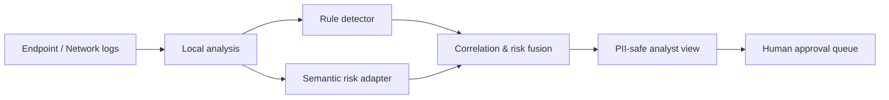

> **중앙 관제 및 로그인:** 분석가 계정, PC별 수집기 등록, Windows 실행과 제한은 [중앙 관제 설정](docs/central_monitoring.md)을 먼저 확인하세요. 실제 Windows Sysmon 수집은 아직 검증되지 않았습니다.

# Aegis-ON

> 개인정보를 외부로 반출하지 않고, 규칙 기반 탐지와 행위 분석을 결합하는 사람 승인형 AI 보안관제 MVP

## 현재 구현 범위

- JSON 보안 이벤트 배치 분석
- Sysmon Event ID 1·3 JSON 배치 수집 및 정규화
- 알려진 위험 명령·도구전송 징후에 대한 설명 가능한 규칙 탐지
- 명령줄 의미 신호를 이용한 **임시 기준선(heuristic) 행위 위험도** 산정
- 호스트·시간창·대상 수 기반 스캔 팬아웃 상관분석
- 이메일·전화번호·IP 주소의 표시용 가명처리
- 선택적으로 로컬 ONNX BERT PII 후보 탐지 및 정규식 기준선과의 합성 구간 평가
- 탐지 근거, MITRE ATT&CK 기법, 위험 점수 및 사람 승인 상태를 API로 제공
- 탐지 결과와 승인 **시뮬레이션**을 로컬 SQLite에 저장하고 재조회

> `SemanticRiskAdapter`는 Transformer가 아닌 키워드 기준선입니다. 별도의 선택적 명령 BERT는 소규모 합성 데이터로 학습한 실험이며 운영 성능을 입증하지 않습니다.

> 개인정보 개체명 인식 모델과 실험용 명령 분류 모델은 서로 다릅니다. 두 모델은 각각 파일을 명시적으로 준비하고 활성화해야 합니다.

## 빠른 시작

브라우저 로그인에 필요한 비밀번호 해시와 환경 변수는 [중앙 관제 설정](docs/central_monitoring.md)에서 안내합니다. Windows 수집기 등록과 실행은 [지속 수집 문서](docs/continuous_collection.md)를 확인하세요. 회원가입이나 실제 차단 기능은 제공하지 않습니다.

기존 자동화 API를 사용할 경우에만 서버에 `AEGIS_API_TOKEN`을 별도로 설정합니다. 아래는 합성 데이터의 수동 API 예시입니다.

샘플 이벤트 분석:

```bash
curl -X POST http://127.0.0.1:8000/api/v1/analyze \
  -H 'Content-Type: application/json' \
  -H "Authorization: Bearer $AEGIS_API_TOKEN" \
  --data @data/demo_events.json
```

분석, 탐지 목록, 승인 API는 기존 Bearer 토큰 또는 유효한 분석가 세션을 요구합니다. 승인 요청의 `analyst`는 `AEGIS_ANALYST_NAME`과 일치해야 합니다. 현재 인증은 **운영자가 설정한 단일 분석가 계정과 선택적 API 공유 토큰**을 제공하며 다중 사용자 인증이나 역할 관리를 제공하지 않습니다. 토큰과 이름은 신뢰하는 분석가에게만 제공하고, 네트워크에 노출할 때는 암호화된 연결과 별도의 접근 통제가 필요합니다.

Docker에서는 영구 SQLite 볼륨과 서버 인증 설정을 전달해야 합니다. 컨테이너 네트워크에서는 호스트 브라우저가 서버 관점에서 loopback이 아닐 수 있으므로, 브라우저 접근에 신뢰된 HTTPS 종단과 프록시 설정을 준비하세요. 단순 포트 매핑만으로 로컬 HTTP 로그인 동작을 보장하지 않습니다.

분석 결과의 `event_refs`는 요청의 0부터 시작하는 `input_index`와 해당 `event_id`를 연결합니다. ID가 없는 입력도 응답을 통해 원본 입력 위치를 찾을 수 있습니다. 한 요청 안에서 `event_id`가 중복되거나 표시용 가명처리 이후 같아지면 요청이 거부됩니다. 이벤트 원본은 저장하지 않으며, 이력에는 필요한 연결 정보만 가명처리해 저장합니다. 수동 분석 API의 상관분석은 요청 단위이며, 연속 Sysmon 수집의 팬아웃은 여러 배치에 걸쳐 집계됩니다.

## 관제 화면 개발

로그인과 관제 화면은 Astryx 0.7.16 및 React를 사용합니다. 서버 배포에는 저장소에 포함된 `static/astryx/` 번들을 제공하므로 Node가 필요하지 않습니다. 프론트엔드 소스를 변경할 때는 Node.js 22 이상에서 다음을 실행하고 생성된 번들도 함께 갱신합니다. 외부 CDN은 사용하지 않습니다.

```bash
cd frontend
npm ci
npm test
```

DOM 테스트는 실제 브라우저 렌더링·키보드·클립보드 검증을 대체하지 않습니다. 라이선스는 [서드파티 고지](frontend/THIRD_PARTY_NOTICES.md)를 확인하세요.

## 로컬 분석 이력

기본 DB는 `~/.aegis-on/history.sqlite3`이며 서버 시작 전 `AEGIS_HISTORY_DB`로 변경할 수 있습니다. 관제 화면에 로그인한 뒤 **분석 이력**에서 이전 결과와 승인 시뮬레이션을 조회할 수 있습니다. API는 인증된 `GET /api/v1/history`를 제공합니다. 분석 응답에 `analysis_id`가 추가됩니다. 저장 실패 시 분석은 503을 반환합니다. 원본 로그나 전체 명령줄은 DB에 자동 저장하지 않지만 가명처리 누락 및 자유 입력 승인 사유에 민감한 내용이 남을 수 있습니다. 비밀값은 입력하지 마세요. 저장 항목, 파일 권한, Docker 볼륨, 삭제 및 제한은 [로컬 이력 문서](docs/local_history.md)를 확인하세요.

회귀 테스트를 포함한 테스트 실행:

```bash
pip install -r requirements-dev.txt
PYTHONPATH=src python -m unittest discover -s tests -v
```

## 명령줄 공격 모델 연구

선택적 로컬 BERT-Tiny 명령 분류는 소규모 합성 데이터로 학습한 실험용이며 기본값은 비활성화입니다. 규칙·키워드 기준선과 개인정보 NER은 별도 기능입니다. 실제 측정, 설정, 오탐과 한계는 [명령줄 공격 분석 연구](docs/command_attack_research.md)를 참고하세요.

## 새로운 명령줄 합성 평가

고정된 합성 사례와 실험용 모델의 재현 결과 및 한계는 [명령줄 평가 프로토콜](docs/command_holdout.md)을 참고하세요.

## 탐지 평가

합성 Sysmon 사례를 이용해 현재 규칙과 키워드 기준선을 재현 가능하게 평가할 수 있습니다. 명령 이벤트와 다중 목적지 연결 배치는 서로 다른 단위로 집계합니다.

```bash
PYTHONPATH=src python -m aegis_on.evaluation --dataset evaluation/synthetic_v1.json --split eval
```

개발용 분할은 `--split dev`로 실행하고 `--output report.json`으로 결과를 파일에 저장할 수 있습니다. 보고서에는 사례별 입력 오류, 탐지 근거, 정답과 예측, 오탐·미탐 및 정밀도·재현율·F1이 포함됩니다. 개인정보 탐지·가명처리 성능은 이 데이터셋의 평가 대상이 아닙니다. 이 소규모 합성 데이터의 결과는 실제 운영 성능이나 모델 성능이 아닙니다. 데이터 분리, 라벨과 점수의 해석은 [탐지 평가 문서](docs/detection_evaluation.md)를 참고하세요.

## 개인정보 후보 탐지

기본 실행은 모델 다운로드나 외부 API 없이 이메일, 한국 휴대전화와 IP에 대한 기존 정규식을 사용합니다. 선택적 로컬 BERT PII 모델의 준비·활성화, 지원 범위와 제한은 [PII 모델 안내](docs/pii_model.md)를 참고하세요. 대시보드에는 모델 상태를 표시하며, 탐지되지 않은 개인정보까지 보호되지는 않습니다.

합성 개인정보 데이터의 구간 평가를 공격 탐지 평가와 별도로 실행합니다.

```bash
PYTHONPATH=src python -m aegis_on.pii_evaluation --dataset evaluation/pii_synthetic_v1.json
```

정확한 구간·유형 일치 기준과 결과 해석은 [PII 평가 문서](docs/pii_evaluation.md)를 참고하세요. 모델이 준비되지 않으면 모델 점수는 산출하지 않습니다.

## 설계



## 합성 시나리오 데모

Mac에서 별도 임시 DB를 사용해 정상 관리자 작업, 인증 실패 후 성공, 팬아웃 경고와 승인 시뮬레이션을 순서대로 시연하려면 [Mac 가상 데이터 관제 시연](docs/mac_presentation.md)을 참고하세요. 현재 PR의 의존 관계와 통합 검토 순서는 [통합 검토 안내](docs/integration_review_plan.md)에 기록했습니다.

서버에는 개인정보와 실제 공격 실행이 포함되지 않은 합성 Sysmon 시나리오 세 개가 있습니다. 각 파일은 기존 Sysmon 분석 API의 입력 형식을 그대로 사용합니다.

- **A — 일반 프로세스:** `notepad.exe` 실행 이벤트 한 건을 처리하며, 현재 기준선에서 탐지가 없습니다. 실제 환경의 모든 정상 활동이 탐지되지 않는다는 뜻은 아닙니다.
- **B — 의심 다운로드 명령:** `curl https://example.org/tool.exe`라는 합성 명령줄에 대해 T1105 규칙이 탐지됩니다. 시스템은 기록을 분석할 뿐 해당 주소에 접속하거나 파일을 다운로드하지 않습니다. 규칙과 임시 기준선에서 각각 탐지가 나올 수 있습니다.
- **C — 발신 연결 팬아웃:** 같은 호스트의 10분 이내 세 발신 연결이 서로 다른 세 목적지를 향할 때 상관 결과가 표시됩니다. 이것만으로 스캔이나 공격이라고 확정할 수 없습니다.

관제 화면에는 수동 입력 버튼이 없습니다. 자동 합성 수집기로 재현하는 방법은 [지속 수집 안내](docs/continuous_collection.md)를 참고하세요. 기존 API를 이용한 시나리오 검증도 아래처럼 가능합니다.

대시보드의 왼쪽 내비게이션, 요약 카드와 탐지 등급 표시는 [ARTEX Global 대시보드](https://github.com/jiwoochris/artex-global/blob/main/screenshots/en/dashboard.png)와 [탐지 목록](https://github.com/jiwoochris/artex-global/blob/main/screenshots/en/findings.png)의 실제 화면 구성을 참고해 Aegis-ON에 맞게 구현했습니다. 기본 화면은 다크 테마이며 ARTEX의 브랜드와 코드는 사용하지 않았습니다.

토큰을 설정하고 서버를 시작한 뒤 시나리오 이름을 `a`, `b`, `c` 중 하나로 바꾸어 실행할 수 있습니다. 두 요청 모두 Bearer 인증이 필요합니다.

```bash
SCENARIO=a
curl -fsS -H "Authorization: Bearer $AEGIS_API_TOKEN" \
  "http://127.0.0.1:8000/api/v1/demo/scenarios/$SCENARIO" | \
  curl -fsS -X POST http://127.0.0.1:8000/api/v1/sysmon/analyze \
    -H "Authorization: Bearer $AEGIS_API_TOKEN" \
    -H 'Content-Type: application/json' --data-binary @-
```

탐지 ID를 이용한 승인 API는 시뮬레이션 상태만 기록하며, 실제 단말 격리나 네트워크 차단을 수행하지 않습니다. 같은 탐지에 승인 요청을 다시 보내면 최초 승인 결과를 반환하고 기존 사유를 유지합니다. 탐지와 승인 이력은 설정된 로컬 SQLite에 저장됩니다. 운영 및 개인정보 보존 범위는 [이력 안내](docs/local_history.md)를 참고하세요.

## Sysmon 로그 분석

Windows Sysmon의 **Event ID 1(프로세스 생성)**과 **Event ID 3(네트워크 연결)**을 지원합니다. Event ID 3은 Sysmon 설정에서 네트워크 이벤트 수집을 활성화해야 생성됩니다. 지원 입력은 이 저장소의 PowerShell 스크립트가 만드는 UTF-8 JSON입니다. Windows 이벤트 뷰어 XML이나 EVTX 파일은 직접 읽지 않습니다.

Windows PowerShell에서 저장소 루트 기준:

```powershell
$LogDir = Join-Path $env:USERPROFILE 'Documents\Aegis-ON-Logs'
New-Item -ItemType Directory -Force -Path $LogDir | Out-Null
.\scripts\export_sysmon.ps1 -OutputPath (Join-Path $LogDir 'sysmon-export.json') -MaxEvents 500
```

Sysmon Operational 채널에 접근할 수 있는 권한이 필요합니다. 사용자의 실제 로그가 JSON에 들어가므로 파일을 신뢰하는 장소에서만 보관·전송하세요. 위 경로는 저장소 밖에 두기 위한 예시입니다. `MaxEvents`는 1~1,000개이며 Sysmon Event 1과 3을 수집합니다. 해당 이벤트가 없거나 채널에 접근할 수 없으면 스크립트가 이유를 표시합니다.

1. 중앙 관제 설정에 따라 분석가 계정과 서버를 설정합니다. API 예시에는 별도 Bearer 토큰이 필요합니다.
2. 자동 수집을 사용하려면 [지속 수집 안내](docs/continuous_collection.md)를 참고하세요.
3. 관제 화면에서 저장된 이벤트와 탐지 근거를 확인합니다. `data/demo_sysmon.json`은 합성 예제입니다.

API로도 같은 파일을 전송할 수 있습니다.

```bash
curl -X POST http://127.0.0.1:8000/api/v1/sysmon/analyze \
  -H "Authorization: Bearer $AEGIS_API_TOKEN" \
  -H 'Content-Type: application/json' \
  --data-binary @data/demo_sysmon.json
```

요청은 JSON 객체의 `events` 배열이며, 각 항목은 `System`과 `EventData` 객체로 구성됩니다. 구체적인 필드와 예시는 `data/demo_sysmon.json`을 참고하세요. `System.Provider`는 `Microsoft-Windows-Sysmon`, `System.Channel`은 `Microsoft-Windows-Sysmon/Operational`이어야 합니다. 각 이벤트는 `System.EventID`, `System.Computer`, 유효한 시각과 `EventData.Image`가 필요하고, Event 3에는 `EventData.DestinationIp`도 필요합니다. 사용자·명령줄 등은 없는 경우 빈 값으로 처리합니다. 명령줄이 없는 이벤트로부터 명령 실행 의도를 만들어내지 않습니다.

`EventData.UtcTime`이 있으면 우선 사용하고 시간대가 없을 때 UTC로 해석합니다. 없으면 시간대가 포함된 `System.TimeCreated`를 사용합니다. 본문은 최대 **2 MiB**, 배열은 최대 **1,000건**입니다. 문서 전체의 JSON 형식이나 크기가 잘못되면 전체 요청을 거부합니다. 개별 항목의 필드 오류 또는 미지원 이벤트는 `items`에 표시하고, 나머지 유효한 이벤트는 처리합니다. 빈 배열은 빈 결과를 반환합니다.

각 입력 이벤트에는 분석 요청마다 새로운 내부 ID가 부여됩니다. 호스트·채널·EventRecordID가 같은 중복 항목은 같은 배치 내에서 두 번째부터 오류로 표시합니다. 레코드 ID가 없으면 분석은 가능하지만 원본 레코드 ID를 표시하거나 다른 배치와 중복을 판정할 수 없습니다. API의 `source_events`는 화면에 필요한 식별 정보와 연결 정보만 반환하며, 원본 명령줄·사용자명·전체 프로세스 경로는 반환하지 않습니다. IP 등은 기존 표시용 가명처리를 거치지만 이는 완전한 익명화가 아닙니다. 전체 원본은 저장하지 않으며, 이벤트의 가명처리된 식별 정보와 탐지 연결만 로컬 이력에 저장합니다.

Sysmon 팬아웃 결과는 **같은 호스트가 10분 이내 서로 다른 목적지 3개 이상으로 발신 연결한 경우**를 표시합니다. Event ID 3의 `Initiated=true`인 이벤트만 집계하며 `false`(수신) 또는 값이 없거나 빈 이벤트는 팬아웃에서 제외합니다. `Initiated`가 없는 구버전 내보내기 파일도 처리할 수 있지만, 이 경우 발신 여부를 확인할 수 없어 해당 이벤트는 팬아웃에 포함하지 않습니다. `true`·`false` 외의 값은 해당 이벤트의 입력 오류로 표시합니다. 결과에 관찰 시작·종료 시각, 목적지 수, 관련 연결 이벤트 수와 조건이 포함됩니다. 이 조건만으로 포트 스캔이나 공격을 확정할 수 없습니다. 현재 결과의 ATT&CK `T1595`는 임시 의심 분류이며, 실제 기법 실행의 증거가 아닙니다. 수동 분석 API는 요청 단위입니다. 수집 API는 배치 간 저장된 이벤트를 비교하고 겹치는 창에 새 근거가 생기면 별도 또는 확장된 검토 경고를 생성합니다. 자원 제한 초과 시 배치 전체가 실패합니다.

## 다음 구현 우선순위

1. 웹 프록시 등 추가 로그 정규화 커넥터
2. `SemanticRiskAdapter`를 다중 라벨 ATT&CK 분류 모델로 교체
3. PostgreSQL 영속화와 조직별 자산 중요도
4. 승인된 격리 요청을 EDR/SOAR에 전달하는 어댑터

실제 대응 어댑터는 기본적으로 비활성화하며, 사람의 승인과 대상 범위 확인 없이는 단말·계정·네트워크를 변경하지 않습니다.

## 관제 화면과 연속 수집

첫 화면 `/`과 `/console`은 관제 개요입니다. `/console/endpoints` 및 `/console/endpoints/{id}`는 호스트 관찰, `/console/detections`는 경고, `/console/events`는 수집 이벤트, `/console/history`는 이력입니다. 수동 파일 업로드와 직접 입력 화면은 제공하지 않습니다. 기존 JSON·Sysmon 분석 API는 유지합니다. 이전 `/console/analysis`는 이벤트 화면으로 이동합니다. 각 화면의 데이터 조회에는 기존 Bearer 인증이 필요합니다. 개요와 이벤트 화면은 인증 후 5초마다 폴링하며 상세 열람·키보드 포커스가 표 안에 있는 동안 목록 갱신을 일시 중지하지만 연결과 수집기 보고는 계속 확인합니다. 연결 실패와 재시도를 표시합니다.

Windows 수집기, 로컬 전용 합성 수집기, 인증·HTTPS 요구 사항과 재시작·중복·롤오버 한계는 [지속 수집 안내](docs/continuous_collection.md)에 설명합니다. Windows 수집기는 **실제 Windows에서 실행하지 않았습니다**. 수집기 상태는 호스트 온라인 상태가 아닙니다. 원문 로그나 전체 명령줄을 새로 저장하지 않지만 가명처리 미탐과 지문 대조 위험이 있습니다.

발신 Sysmon Event ID 3의 다수 목적지 연결은 같은 수집기·호스트의 10분 범위에서 목적지 3개 이상인 경우 여러 수집 배치에 걸쳐 분석합니다. 이벤트 발생 시각 기준이며 재시작 후에도 저장된 정보가 사용됩니다. 다른 수집기의 같은 이벤트와 v3 이전 이력 중복, 로그 재설정, 롤오버는 완전히 판별하지 못합니다. 이전 v3 이벤트의 구형 지문은 전체 원본을 검증할 수 없어 새 배치 키로 재전송하면 409로 중단합니다. JSON 수집은 이벤트 단위 중복 제거 없이 동일 배치 재전송만 방지합니다. 겹치는 창의 새 근거는 기존 경고에 완전히 포함되는 경우를 제외하고 보존합니다. 승인된 경고는 변경하지 않습니다. 자세한 정책과 자원 제한은 [지속 수집 안내](docs/continuous_collection.md)를 참고하세요. 공격 확정이 아닙니다. 호스트 묶음은 수집기와 호스트 이름의 지문을 사용하며 실제 장치 동일성은 보장하지 않습니다. 인증·PII·SQLite와 승인 시뮬레이션은 유지됩니다.

화면은 [Wazuh](https://documentation.wazuh.com/current/user-manual/wazuh-dashboard/navigating-the-wazuh-dashboard.html), [Elastic Security](https://www.elastic.co/docs/solutions/security/dashboards/detection-response-dashboard), [Microsoft Defender](https://learn.microsoft.com/en-us/defender-xdr/investigate-incident-cases), [ARTEX Global](https://github.com/jiwoochris/artex-global/tree/main/screenshots/en)의 정보 탐색 흐름을 참고했습니다.

다중 로그 프로토타입의 구현 범위와 인증 입력 형식, 모델 및 검증 한계는 [다중 로그 관제 문서](docs/multisource_prototype.md)를 참고하세요.
