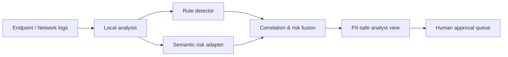

# Aegis-ON

> 개인정보를 외부로 반출하지 않고, 규칙 기반 탐지와 행위 분석을 결합하는 사람 승인형 AI 보안관제 MVP

## 현재 구현 범위

- JSON 보안 이벤트 배치 분석
- Sysmon Event ID 1·3 JSON 배치 수집 및 정규화
- 알려진 위험 명령·도구전송 징후에 대한 설명 가능한 규칙 탐지
- 명령줄 의미 신호를 이용한 **임시 기준선(heuristic) 행위 위험도** 산정
- 호스트·시간창·대상 수 기반 스캔 팬아웃 상관분석
- 이메일·전화번호·IP 주소의 표시용 가명처리
- 선택적으로 로컬 ONNX BERT PII 후보 탐지 및 정규식 기준선과의 합성 구간 평가
- 탐지 근거, MITRE ATT&CK 기법, 위험 점수 및 사람 승인 상태를 API로 제공
- 탐지 결과와 승인 **시뮬레이션**을 로컬 SQLite에 저장하고 재조회

> `SemanticRiskAdapter`는 Transformer가 아닌 키워드 기준선입니다. 별도의 선택적 명령 BERT는 소규모 합성 데이터로 학습한 실험이며 운영 성능을 입증하지 않습니다.

> 개인정보 개체명 인식 모델과 실험용 명령 분류 모델은 서로 다릅니다. 두 모델은 각각 파일을 명시적으로 준비하고 활성화해야 합니다.

## 빠른 시작

```bash
python -m venv .venv
source .venv/bin/activate
pip install -r requirements.txt
export AEGIS_API_TOKEN="$(python -c 'import secrets; print(secrets.token_urlsafe(32))')"
export AEGIS_ANALYST_NAME="analyst-1"
uvicorn --app-dir src aegis_on.api:app --reload
```

브라우저에서 `http://127.0.0.1:8000`을 열고 데모 버튼을 누르면 API 토큰을 입력합니다. 생성된 토큰은 `printf '%s\n' "$AEGIS_API_TOKEN"`으로 확인할 수 있습니다. API 문서는 `http://127.0.0.1:8000/docs`에서 확인하고 Authorize에 토큰을 입력합니다.

Windows PowerShell에서는 저장소 루트에서 다음 명령을 사용합니다. 가상환경을 직접 활성화하지 않아도 됩니다.

```powershell
py -3 -m venv .venv
.\.venv\Scripts\python.exe -m pip install -r requirements.txt
$env:AEGIS_API_TOKEN = (.\.venv\Scripts\python.exe -c "import secrets; print(secrets.token_urlsafe(32))")
$env:AEGIS_ANALYST_NAME = 'analyst-1'
Write-Host $env:AEGIS_API_TOKEN
.\.venv\Scripts\python.exe -m uvicorn --app-dir src aegis_on.api:app --reload
```

토큰은 서버를 시작한 PowerShell 세션에 설정됩니다. 서버를 종료하려면 `Ctrl+C`를 누릅니다.

샘플 이벤트 분석:

```bash
curl -X POST http://127.0.0.1:8000/api/v1/analyze \
  -H 'Content-Type: application/json' \
  -H "Authorization: Bearer $AEGIS_API_TOKEN" \
  --data @data/demo_events.json
```

분석, 탐지 목록, 승인 API에는 Bearer 토큰이 필요합니다. 토큰 또는 분석가 이름이 설정되지 않으면 API는 요청을 거부합니다. 승인 요청의 `analyst`는 `AEGIS_ANALYST_NAME`과 일치해야 합니다. 현재 인증은 **단일 공유 토큰과 단일 분석가를 위한 MVP**이며 다중 사용자 인증이나 역할 관리를 제공하지 않습니다. 토큰과 이름은 신뢰하는 분석가에게만 제공하고, 네트워크에 노출할 때는 암호화된 연결과 별도의 접근 통제가 필요합니다.

Docker를 사용한다면 환경 변수를 컨테이너에 전달하고 호스트의 루프백에 포트를 연결합니다.

```bash
docker build -t aegis-on .
docker run --rm -p 127.0.0.1:8000:8000 -e AEGIS_API_TOKEN -e AEGIS_ANALYST_NAME aegis-on
```

분석 결과의 `event_refs`는 요청의 0부터 시작하는 `input_index`와 해당 `event_id`를 연결합니다. ID가 없는 입력도 응답을 통해 원본 입력 위치를 찾을 수 있습니다. 한 요청 안에서 `event_id`가 중복되거나 표시용 가명처리 이후 같아지면 요청이 거부됩니다. 이벤트 원본은 저장하지 않으며, 이력에는 필요한 연결 정보만 가명처리해 저장합니다. 상관분석은 한 번의 요청에 포함된 이벤트에 적용됩니다.

## 로컬 분석 이력

기본 DB는 `~/.aegis-on/history.sqlite3`이며 서버 시작 전 `AEGIS_HISTORY_DB`로 변경할 수 있습니다. 분석 후 대시보드의 **로컬 분석 이력 → 이력 불러오기**에서 토큰을 입력하면 이전 결과와 승인 시뮬레이션을 조회할 수 있습니다. API는 인증된 `GET /api/v1/history`를 제공합니다. 분석 응답에 `analysis_id`가 추가됩니다. 저장 실패 시 분석은 503을 반환합니다. 원본 로그나 전체 명령줄은 DB에 자동 저장하지 않지만 가명처리 누락 및 자유 입력 승인 사유에 민감한 내용이 남을 수 있습니다. 비밀값은 입력하지 마세요. 저장 항목, 파일 권한, Docker 볼륨, 삭제 및 제한은 [로컬 이력 문서](docs/local_history.md)를 확인하세요.

회귀 테스트를 포함한 테스트 실행:

```bash
pip install -r requirements-dev.txt
PYTHONPATH=src python -m unittest discover -s tests -v
```

## 명령줄 공격 모델 연구

선택적 로컬 BERT-Tiny 명령 분류는 소규모 합성 데이터로 학습한 실험용이며 기본값은 비활성화입니다. 규칙·키워드 기준선과 개인정보 NER은 별도 기능입니다. 실제 측정, 설정, 오탐과 한계는 [명령줄 공격 분석 연구](docs/command_attack_research.md)를 참고하세요.

## 새로운 명령줄 합성 평가

고정된 합성 사례와 실험용 모델의 재현 결과 및 한계는 [명령줄 평가 프로토콜](docs/command_holdout.md)을 참고하세요.

## 탐지 평가

합성 Sysmon 사례를 이용해 현재 규칙과 키워드 기준선을 재현 가능하게 평가할 수 있습니다. 명령 이벤트와 다중 목적지 연결 배치는 서로 다른 단위로 집계합니다.

```bash
PYTHONPATH=src python -m aegis_on.evaluation --dataset evaluation/synthetic_v1.json --split eval
```

개발용 분할은 `--split dev`로 실행하고 `--output report.json`으로 결과를 파일에 저장할 수 있습니다. 보고서에는 사례별 입력 오류, 탐지 근거, 정답과 예측, 오탐·미탐 및 정밀도·재현율·F1이 포함됩니다. 개인정보 탐지·가명처리 성능은 이 데이터셋의 평가 대상이 아닙니다. 이 소규모 합성 데이터의 결과는 실제 운영 성능이나 모델 성능이 아닙니다. 데이터 분리, 라벨과 점수의 해석은 [탐지 평가 문서](docs/detection_evaluation.md)를 참고하세요.

## 개인정보 후보 탐지

기본 실행은 모델 다운로드나 외부 API 없이 이메일, 한국 휴대전화와 IP에 대한 기존 정규식을 사용합니다. 선택적 로컬 BERT PII 모델의 준비·활성화, 지원 범위와 제한은 [PII 모델 안내](docs/pii_model.md)를 참고하세요. 대시보드에는 모델 상태와 정규식·모델 후보의 유형 및 가명 토큰을 표시하며, 탐지되지 않은 개인정보까지 보호되지는 않습니다.

합성 개인정보 데이터의 구간 평가를 공격 탐지 평가와 별도로 실행합니다.

```bash
PYTHONPATH=src python -m aegis_on.pii_evaluation --dataset evaluation/pii_synthetic_v1.json
```

정확한 구간·유형 일치 기준과 결과 해석은 [PII 평가 문서](docs/pii_evaluation.md)를 참고하세요. 모델이 준비되지 않으면 모델 점수는 산출하지 않습니다.

## 설계



## 합성 시나리오 데모

서버에는 개인정보와 실제 공격 실행이 포함되지 않은 합성 Sysmon 시나리오 세 개가 있습니다. 각 파일은 기존 Sysmon 분석 API의 입력 형식을 그대로 사용합니다.

- **A — 일반 프로세스:** `notepad.exe` 실행 이벤트 한 건을 처리하며, 현재 기준선에서 탐지가 없습니다. 실제 환경의 모든 정상 활동이 탐지되지 않는다는 뜻은 아닙니다.
- **B — 의심 다운로드 명령:** `curl https://example.org/tool.exe`라는 합성 명령줄에 대해 T1105 규칙이 탐지됩니다. 시스템은 기록을 분석할 뿐 해당 주소에 접속하거나 파일을 다운로드하지 않습니다. 규칙과 임시 기준선에서 각각 탐지가 나올 수 있습니다.
- **C — 발신 연결 팬아웃:** 같은 호스트의 10분 이내 세 발신 연결이 서로 다른 세 목적지를 향할 때 상관 결과가 표시됩니다. 이것만으로 스캔이나 공격이라고 확정할 수 없습니다.

대시보드에서 **A · 정상 프로세스**, **B · 의심 다운로드 명령**, **C · 다수 목적지 연결**을 누르고 API 토큰을 입력하면 선택한 샘플을 즉시 분석합니다. 각 결과에서 탐지 근거와 연결된 원본 이벤트의 식별 정보를 확인할 수 있습니다. 탐지 카드의 **시뮬레이션 승인**을 누른 후 API 토큰과 설정된 분석가 이름을 입력하면 승인 상태가 기록됩니다. 실제 차단은 수행되지 않습니다. A에는 탐지가 없지만 처리된 이벤트의 식별 정보를 확인할 수 있습니다.

대시보드의 왼쪽 내비게이션, 요약 카드와 탐지 등급 표시는 [ARTEX Global 대시보드](https://github.com/jiwoochris/artex-global/blob/main/screenshots/en/dashboard.png)와 [탐지 목록](https://github.com/jiwoochris/artex-global/blob/main/screenshots/en/findings.png)의 실제 화면 구성을 참고해 Aegis-ON에 맞게 구현했습니다. 기본 화면은 다크 테마이며 ARTEX의 브랜드와 코드는 사용하지 않았습니다.

토큰을 설정하고 서버를 시작한 뒤 시나리오 이름을 `a`, `b`, `c` 중 하나로 바꾸어 실행할 수 있습니다. 두 요청 모두 Bearer 인증이 필요합니다.

```bash
SCENARIO=a
curl -fsS -H "Authorization: Bearer $AEGIS_API_TOKEN" \
  "http://127.0.0.1:8000/api/v1/demo/scenarios/$SCENARIO" | \
  curl -fsS -X POST http://127.0.0.1:8000/api/v1/sysmon/analyze \
    -H "Authorization: Bearer $AEGIS_API_TOKEN" \
    -H 'Content-Type: application/json' --data-binary @-
```

탐지 ID를 이용한 승인 API는 시뮬레이션 상태만 기록하며, 실제 단말 격리나 네트워크 차단을 수행하지 않습니다. 같은 탐지에 승인 요청을 다시 보내면 최초 승인 결과를 반환하고 기존 사유를 유지합니다. 탐지와 승인 이력은 설정된 로컬 SQLite에 저장됩니다. 운영 및 개인정보 보존 범위는 [이력 안내](docs/local_history.md)를 참고하세요.

## Sysmon 로그 분석

Windows Sysmon의 **Event ID 1(프로세스 생성)**과 **Event ID 3(네트워크 연결)**을 지원합니다. Event ID 3은 Sysmon 설정에서 네트워크 이벤트 수집을 활성화해야 생성됩니다. 지원 입력은 이 저장소의 PowerShell 스크립트가 만드는 UTF-8 JSON입니다. Windows 이벤트 뷰어 XML이나 EVTX 파일은 직접 읽지 않습니다.

Windows PowerShell에서 저장소 루트 기준:

```powershell
$LogDir = Join-Path $env:USERPROFILE 'Documents\Aegis-ON-Logs'
New-Item -ItemType Directory -Force -Path $LogDir | Out-Null
.\scripts\export_sysmon.ps1 -OutputPath (Join-Path $LogDir 'sysmon-export.json') -MaxEvents 500
```

Sysmon Operational 채널에 접근할 수 있는 권한이 필요합니다. 사용자의 실제 로그가 JSON에 들어가므로 파일을 신뢰하는 장소에서만 보관·전송하세요. 위 경로는 저장소 밖에 두기 위한 예시입니다. `MaxEvents`는 1~1,000개이며 Sysmon Event 1과 3을 수집합니다. 해당 이벤트가 없거나 채널에 접근할 수 없으면 스크립트가 이유를 표시합니다.

1. 빠른 시작의 API 토큰과 분석가 이름을 설정하고 서버를 시작합니다.
2. 대시보드에서 JSON 파일을 선택하고 **파일 분석**을 눌러 토큰을 입력합니다.
3. 처리·오류·미지원 개수와 항목별 상태를 확인하고, 탐지 카드에서 원본 이벤트의 레코드 ID·출처·시각 및 관련 연결 정보를 확인합니다. `data/demo_sysmon.json`은 개인정보가 없는 합성 예제입니다.

API로도 같은 파일을 전송할 수 있습니다.

```bash
curl -X POST http://127.0.0.1:8000/api/v1/sysmon/analyze \
  -H "Authorization: Bearer $AEGIS_API_TOKEN" \
  -H 'Content-Type: application/json' \
  --data-binary @data/demo_sysmon.json
```

요청은 JSON 객체의 `events` 배열이며, 각 항목은 `System`과 `EventData` 객체로 구성됩니다. 구체적인 필드와 예시는 `data/demo_sysmon.json`을 참고하세요. `System.Provider`는 `Microsoft-Windows-Sysmon`, `System.Channel`은 `Microsoft-Windows-Sysmon/Operational`이어야 합니다. 각 이벤트는 `System.EventID`, `System.Computer`, 유효한 시각과 `EventData.Image`가 필요하고, Event 3에는 `EventData.DestinationIp`도 필요합니다. 사용자·명령줄 등은 없는 경우 빈 값으로 처리합니다. 명령줄이 없는 이벤트로부터 명령 실행 의도를 만들어내지 않습니다.

`EventData.UtcTime`이 있으면 우선 사용하고 시간대가 없을 때 UTC로 해석합니다. 없으면 시간대가 포함된 `System.TimeCreated`를 사용합니다. 본문은 최대 **2 MiB**, 배열은 최대 **1,000건**입니다. 문서 전체의 JSON 형식이나 크기가 잘못되면 전체 요청을 거부합니다. 개별 항목의 필드 오류 또는 미지원 이벤트는 `items`에 표시하고, 나머지 유효한 이벤트는 처리합니다. 빈 배열은 빈 결과를 반환합니다.

각 입력 이벤트에는 분석 요청마다 새로운 내부 ID가 부여됩니다. 호스트·채널·EventRecordID가 같은 중복 항목은 같은 배치 내에서 두 번째부터 오류로 표시합니다. 레코드 ID가 없으면 분석은 가능하지만 원본 레코드 ID를 표시하거나 다른 배치와 중복을 판정할 수 없습니다. API의 `source_events`는 화면에 필요한 식별 정보와 연결 정보만 반환하며, 원본 명령줄·사용자명·전체 프로세스 경로는 반환하지 않습니다. IP 등은 기존 표시용 가명처리를 거치지만 이는 완전한 익명화가 아닙니다. 원본 이벤트와 매핑은 서버에 영구 저장되지 않습니다.

Sysmon 팬아웃 결과는 **같은 호스트가 10분 이내 서로 다른 목적지 3개 이상으로 발신 연결한 경우**를 표시합니다. Event ID 3의 `Initiated=true`인 이벤트만 집계하며 `false`(수신) 또는 값이 없거나 빈 이벤트는 팬아웃에서 제외합니다. `Initiated`가 없는 구버전 내보내기 파일도 처리할 수 있지만, 이 경우 발신 여부를 확인할 수 없어 해당 이벤트는 팬아웃에 포함하지 않습니다. `true`·`false` 외의 값은 해당 이벤트의 입력 오류로 표시합니다. 결과에 관찰 시작·종료 시각, 목적지 수, 관련 연결 이벤트 수와 조건이 포함됩니다. 이 조건만으로 포트 스캔이나 공격을 확정할 수 없습니다. 현재 결과의 ATT&CK `T1595`는 임시 의심 분류이며, 실제 기법 실행의 증거가 아닙니다. 상관분석은 요청 단위이며 중복을 줄이기 위해 겹치지 않는 시간 창을 사용하므로 창 경계를 가로지르는 활동은 누락될 수 있습니다.

## 다음 구현 우선순위

1. 웹 프록시 등 추가 로그 정규화 커넥터
2. `SemanticRiskAdapter`를 다중 라벨 ATT&CK 분류 모델로 교체
3. PostgreSQL 영속화와 조직별 자산 중요도
4. 승인된 격리 요청을 EDR/SOAR에 전달하는 어댑터

실제 대응 어댑터는 기본적으로 비활성화하며, 사람의 승인과 대상 범위 확인 없이는 단말·계정·네트워크를 변경하지 않습니다.

## 관제 화면과 연속 수집

서버의 첫 화면 `/`과 `/console`은 관제 개요입니다. `/console/endpoints` 및 `/console/endpoints/{id}`는 분석별 호스트 관찰, `/console/detections`는 탐지 상세, `/console/analysis`는 기존 JSON·Sysmon 분석과 데모, `/console/history`는 분석·승인 시뮬레이션 이력입니다. 직접 URL, 새로고침, 뒤로 가기를 지원하며 예전 `/#analysis`, `/#result-section`, `/#history`, `/#overview`는 해당 화면으로 이동합니다. HTML은 공개 셸이지만 데이터 API는 기존 Bearer 인증이 필요합니다. **인증하고 불러오기**에서 토큰을 입력하면 관제 개요가 5초마다 인증된 폴링으로 저장된 이벤트·탐지와 수집기 보고를 조회합니다. 공개 스트림을 유지할 필요가 없는 로컬 구조라 폴링을 사용합니다. 상세 열람 중이거나 결과 표의 키보드 포커스가 유지되는 동안에는 자동 갱신이 일시 중지됩니다. 상세를 닫거나 표 밖으로 포커스를 옮기면 다시 갱신합니다. 연결 오류·재시도·복구 상태와 마지막 성공 이후 오래된 화면임을 알립니다. 토큰은 URL이나 DB에 저장하지 않습니다. HTTP 서버는 루프백에만 바인딩하세요. 원격 접근에는 별도의 인증·TLS·접근 제한이 필요하며 이 구현에서 제공하지 않습니다.

`POST /api/v1/ingest/json` 또는 `/api/v1/ingest/sysmon`은 인증된 연속 수집 경로입니다. 기존 분석 API와 동일한 JSON 본문과 `X-Collector-ID`, `Idempotency-Key`를 전달합니다. Sysmon 수집 배치는 오류·미지원 항목이 하나라도 있으면 전체 거부하여 수집기 체크포인트가 진행되지 않게 합니다. 기존 수동 Sysmon 분석은 유효 이벤트 부분 처리 방식을 유지합니다. 전송한 전체 배치가 분석 및 저장된 뒤에만 성공 응답이 나갑니다. 규칙·상관분석과 활성화된 모델은 기존 분석 경로를 사용하며 상관분석은 수신 배치 내에서만 이뤄집니다. 서로 다른 배치에 나뉜 이벤트의 팬아웃은 분석하지 못합니다.

같은 수집기·동일 키·동일 본문의 재전송은 기존 결과를 반환합니다. 같은 키에 다른 본문이나 형식은 충돌로 거부합니다. **서로 다른 키로 보낸 동일 이벤트의 중복은 제거하지 않습니다.** 로그 롤오버, 채널 초기화, 체크포인트 손실 또는 수집기 가동 전 데이터까지 복구한다고 보장하지 않습니다. 서버는 배치 본문의 SHA-256과 수집기·배치 식별자를 기록합니다. 해시는 원문이 아니지만 추측 가능한 본문의 일치 여부를 확인하는 데 사용될 수 있습니다. 식별자에는 개인정보·호스트명·토큰을 넣지 말고 임의의 비민감 값을 사용하세요. 기존 공통 토큰은 수집기별 권한이나 신원을 구분하지 않으므로 ID는 장치 소유권의 증거가 아닙니다. 재시도에는 JSON 공백과 인코딩까지 같은 UTF-8 본문 바이트를 보내야 합니다.

수집기는 `POST /api/v1/collectors/{id}/heartbeat`로 `running`, `error`, `stopped` 및 정해진 오류 코드를 보고하며, 인증된 `GET /api/v1/collectors`에서 마지막 수신과 보고 시각을 확인합니다. 이는 **수집기 본인이 마지막으로 보고한 상태**입니다. 30초 동안 보고가 없으면 화면은 최근 보고 없음을 표시하고, 단말 온라인 여부나 무손실 수집을 보장하지 않습니다. 서버에 연결할 수 없는 동안 오류 보고도 서버에 도달하지 못할 수 있습니다.

### Windows Sysmon 연속 수집 (실제 Windows 미검증)

실험용 `scripts/collect_sysmon.ps1`은 로컬 Sysmon Operational 채널의 Event ID 1·3을 읽어 루프백 서버로 전송합니다. Sysmon을 설치하거나 설정을 변경하지 않습니다. Event ID 3은 Sysmon 설정에서 수집하도록 켜져 있어야 합니다. PowerShell과 Sysmon이 있는 Windows에서 먼저 사용자에게 권한과 기존 설정을 확인한 후, 저장소 외부의 비공개 디렉터리를 준비하세요.

```powershell
$Secret = Read-Host '서버 API 토큰' -AsSecureString
$env:AEGIS_API_TOKEN = [System.Net.NetworkCredential]::new('', $Secret).Password
Remove-Variable Secret
New-Item -ItemType Directory -Force "$env:LOCALAPPDATA\Aegis-ON" | Out-Null
.\scripts\collect_sysmon.ps1 -CollectorId 'collector-01' -CursorPath "$env:LOCALAPPDATA\Aegis-ON\cursor.txt"
```

서버는 같은 컴퓨터의 `127.0.0.1:8000`에서 실행해야 합니다. 최초 실행 시 현재 채널 끝에서 시작하므로 이전 이벤트는 가져오지 않습니다. 성공 응답 전에 체크포인트를 진행하지 않으며 재시도할 배치의 레코드 번호만 별도 파일에 남깁니다. 채널 삭제·롤오버가 의심되거나 체크포인트가 손상되면 중단하고 확인해야 합니다. 허용되지 않는 이벤트나 전송 오류로 배치가 거부되면 체크포인트는 진행되지 않고 재시도되므로 원인을 해결해야 합니다. 체크포인트를 임의로 삭제하면 재수집이나 누락이 생길 수 있습니다. Sysmon 자체가 해당 이벤트를 생성하지 않았거나 로그가 보존 기간보다 오래 중단된 경우 복구할 수 없습니다. 채널 삭제 후 레코드 번호가 재사용되면 단순 범위 검사로 초기화를 놓칠 수 있습니다. 이 스크립트의 구문·Windows 동작과 실제 Sysmon은 아직 검증하지 않았습니다.

엔드포인트는 자산 목록이나 온라인 상태가 아닙니다. 인증된 `GET /api/v1/endpoints`와 `GET /api/v1/endpoints/{id}`는 저장된 가명처리 이력에서 **단일 분석별 관찰 묶음**을 파생합니다. 서로 다른 분석은 병합하지 않으며 같은 가명도 실제 동일 장치임을 보장하지 않습니다. 짧은 가명은 충돌할 수 있고 요청별 개인정보 후보에 따라 동일 호스트의 가명이 바뀔 수 있습니다. 호스트가 없으면 이벤트별 미상으로 처리합니다. JSON 이력에는 이벤트별 호스트가 없어 탐지와 연결된 경우만 호스트를 추정할 수 있으며 나머지는 미상입니다. JSON 이력의 마지막 이벤트 시각은 저장되지 않았으면 확인 불가입니다. 하나의 탐지가 여러 관찰 묶음에 연결될 수 있어 묶음별 탐지 수의 합은 고유 탐지 수가 아닙니다.

원본 로그와 전체 명령줄을 새로 영구 저장하지 않습니다. SQLite의 기존 가명처리 한계와 공개 호스트 예외는 [이력 안내](docs/local_history.md)를 따르며 모든 개인정보 제거를 보장하지 않습니다. 직접 입력한 JSON 원문은 지우거나 페이지를 벗어날 때까지 입력창에 남을 수 있습니다. 모델 분류는 탐지 목록과 별도로 표시하며 ATT&CK 기법이나 실제 공격 확률을 예측하지 않습니다. 승인은 실제 차단이 아닌 시뮬레이션입니다.

화면 구성은 [Wazuh 대시보드](https://documentation.wazuh.com/current/user-manual/wazuh-dashboard/navigating-the-wazuh-dashboard.html), [Elastic Detection & Response](https://www.elastic.co/docs/solutions/security/dashboards/detection-response-dashboard), [Microsoft Defender 사건 조사](https://learn.microsoft.com/en-us/defender-xdr/investigate-incident-cases), [ARTEX Global 화면](https://github.com/jiwoochris/artex-global/tree/main/screenshots/en)의 탐지·자산·근거 탐색 흐름을 참고했습니다. 이들 제품의 모든 기능을 지원한다는 의미는 아닙니다.
